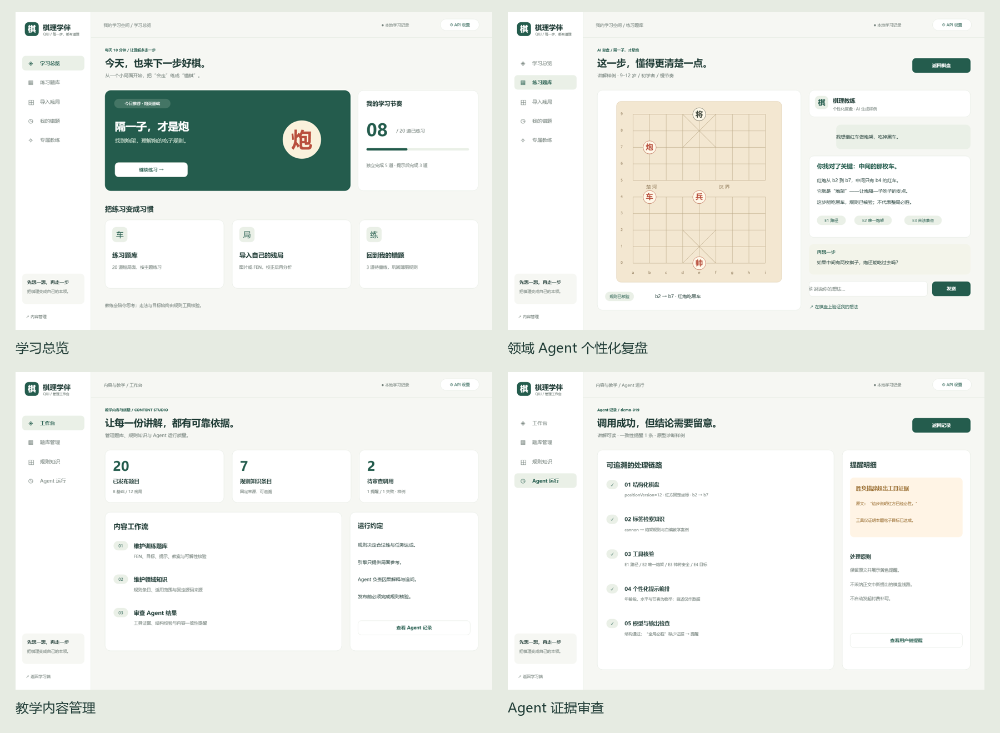

# 棋理学伴原型设计

**[下载完整原型压缩包 qili-prototype.zip](qili-prototype.zip)**

下载后完整解压，进入 `qili-prototype` 文件夹，双击 **`index.html`** 即可使用；Windows也可双击 **`打开原型.cmd`**。无需安装开发环境、启动服务器或配置密钥。

本设计使用专用原型工具 **Evolus Pencil 4.0.0**，涵盖43个页面与状态，包含用户端、后台管理、移动端和领域Agent主要任务流程。演示全部使用样例数据。

- [原生可编辑工程](qili-prototype.epgz)：使用Pencil编辑；无需Pencil也能体验压缩包内的HTML原型。
- [交互与规则说明](交互与规则说明.md)：任务流程、判定规则、异常状态和设计依据。
- [SHA-256校验值](SHA256SUMS.txt)：可检查下载文件是否完整。

主要交互包括自主训练、三级提示、个性化复盘与追问、合法摆谱、图片校准与人工确认、后台题目核验及模拟发布。

